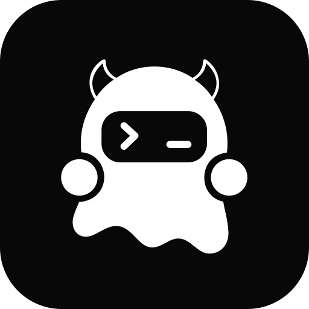
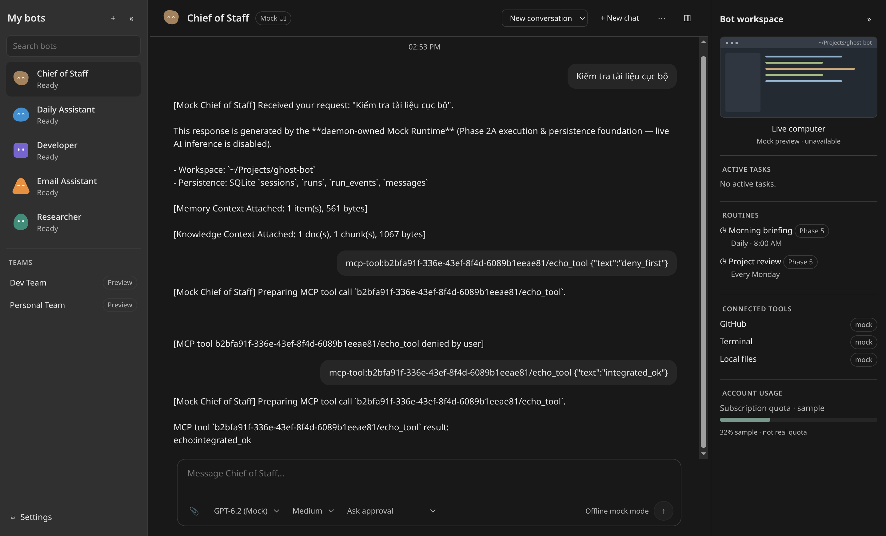
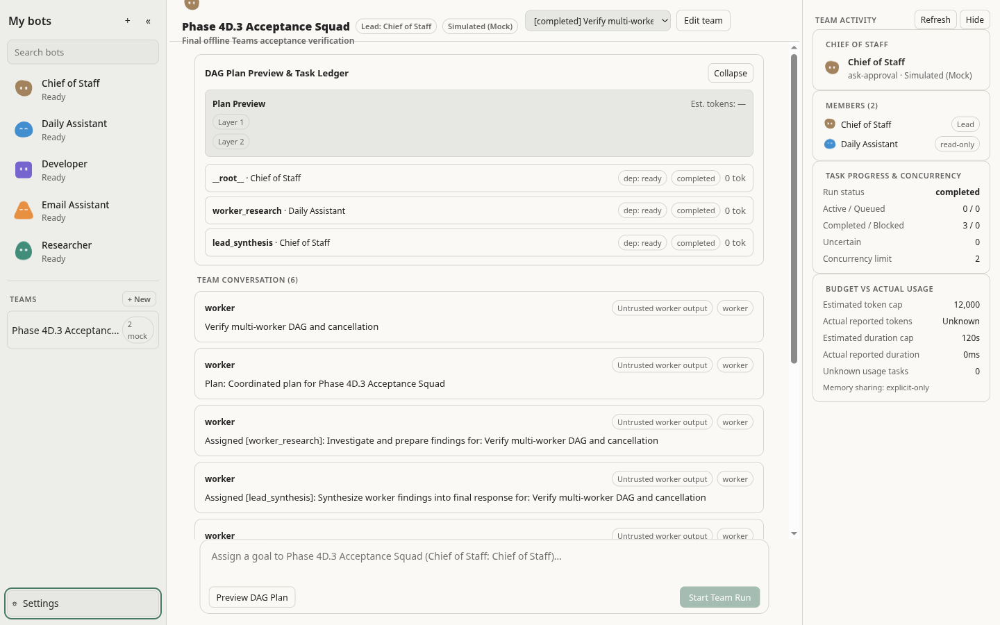

<p align="center">
  
</p>

<h1 align="center">Ghost Bot</h1>

<p align="center"><strong>Your AI team, in one local-first workspace.</strong></p>

<p align="center">
  <a href="LICENSE"></a>
  <a href="LICENSE-MIT"></a>
  <a href="docs/ROADMAP.md"></a>
  
  
  
</p>

---

<p align="center">
  <a href="https://github.com/nvndy27/ghost-bot/actions/workflows/ci.yml"></a>
  <a href="https://github.com/nvndy27/ghost-bot/actions/workflows/codeql.yml"></a>
  <a href="https://github.com/nvndy27/ghost-bot/actions/workflows/scorecard.yml"></a>
  <a href="docs/OPEN_SOURCE_READINESS.md#outstanding-before-claiming-compliance-or-releasing-binaries"></a>
  <a href="docs/OPEN_SOURCE_READINESS.md#outstanding-before-claiming-compliance-or-releasing-binaries"></a>
  <a href="https://github.com/nvndy27/ghost-bot/actions/workflows/sbom.yml"></a>
</p>

<p align="center">
  <a href="https://github.com/nvndy27/ghost-bot/actions">Workflow results</a> ·
  <a href="https://scorecard.dev/viewer/?uri=github.com/nvndy27/ghost-bot">Scorecard report</a> ·
  <a href="docs/OPEN_SOURCE_READINESS.md">Open-source readiness</a>
</p>

<p align="center"><sub>Live workflow status · <a href="docs/OPEN_SOURCE_READINESS.md">Compliance and release readiness</a></sub></p>

Ghost Bot is a local-first desktop workspace for AI assistants, developers and multi-agent collaboration. Bring your own supported AI accounts, API keys or local models, and keep your conversations and project workspace together.

**Early Alpha:** Linux development builds are available from source. A stable public installer has not been released yet.

## Workspace

<p align="center">
  
  <br />
  <sub>Personal assistant workspace — earlier development screenshot, offline mock session.</sub>
</p>

<p align="center">
  
  <br />
  <sub>Team workspace — earlier development screenshot, simulated collaboration.</sub>
</p>

## Features

- **Personal AI assistants:** configurable bots, persistent conversations, model selection, streaming and cancellation.
- **Multiple AI runtimes:** connect supported services and local models using your own credentials.
- **Workspace tools:** inspect authorized files, use the right-hand workspace panel and manage project context. File writes are currently gated; Git changes, live previews and additional editor features are in development.
- **Agent collaboration:** team coordination and task tracking; multi-model group discussion and private task chats are being developed.
- **Memory, knowledge and tools:** scoped local context, MCP, routines and isolated computer-use foundations; availability depends on the runtime and permissions.
- **Local-first:** local conversation storage, light and dark themes, and explicit permission boundaries.

Ghost Bot does not provide subscriptions or API credits. Provider availability varies; see the [supported runtime matrix](docs/PROVIDER_MATRIX.md). The Codex route has prior live acceptance; other adapters may require host setup and further live verification.

## Installation

### Build from source (Linux)

Requirements: Linux x86_64, Git, Node.js 24 or newer, Corepack with pnpm 10.34.9 (pinned in `package.json`), and a Secret Service-compatible keyring for supported credential storage. Fedora is the previously verified packaging target; other platforms require separate validation.

```bash
git clone https://github.com/nvndy27/ghost-bot.git
cd ghost-bot
corepack pnpm install --frozen-lockfile
corepack pnpm build
corepack pnpm --filter @ghost-bot/desktop exec electron .
```

Run as a normal user. Do not disable the Electron sandbox. For UI-only development, `corepack pnpm dev` starts the Vite renderer, not the full desktop app.

### Build a desktop package

From the repository root:

```bash
# AppImage
corepack pnpm package:appimage

# Native Fedora RPM (requires rpmbuild)
corepack pnpm package:rpm
```

Artifacts are generated in `apps/desktop/release/`. To launch a locally built AppImage:

```bash
cd apps/desktop/release
chmod +x GhostBot-0.1.0-x86_64.AppImage
./GhostBot-0.1.0-x86_64.AppImage
```

If FUSE is unavailable, use:

```bash
APPIMAGE_EXTRACT_AND_RUN=1 ./GhostBot-0.1.0-x86_64.AppImage
```

To install a locally built RPM on Fedora, after reviewing the package:

```bash
sudo dnf install ./ghost-bot-0.1.0-1.x86_64.rpm
```

Earlier development packages were smoke-tested on Fedora; the current checkout and new logo still require a fresh packaging check. See [packaging prerequisites and limitations](docs/PHASE2_RELEASE_REPORT.md).

### Connect an AI provider

Open **Settings → Accounts & Providers** and configure a supported provider or local runtime. For the previously verified Codex integration, install the official Codex CLI separately and sign in using Ghost Bot's dedicated profile:

```bash
CODEX_HOME="$HOME/.config/ghost-bot/codex-profile" codex login --device-auth
```

Your regular Codex profile is not replaced. Select a discovered model, create a bot and start a conversation. Paid API calls require opt-in. External providers receive the context necessary for their requests; local-first does not mean fully offline.

## Contributing

Contributions and feedback are welcome. Read [CONTRIBUTING.md](CONTRIBUTING.md) and [AGENTS.md](AGENTS.md) before making changes. For engineering details, see the [roadmap](docs/ROADMAP.md), [architecture](docs/ARCHITECTURE.md) and [test plan](docs/TEST_PLAN.md). Report vulnerabilities using [SECURITY.md](SECURITY.md).

```bash
corepack pnpm lint
corepack pnpm typecheck
corepack pnpm build
corepack pnpm test
corepack pnpm -r --if-present test
```

## License

Original Ghost Bot code and documentation are available under the [MIT License](LICENSE-MIT) or [Apache License 2.0](LICENSE), at your option. See [NOTICE](NOTICE) for scope and attribution. Third-party materials retain their own licenses; reference screenshots under `design/references/` are excluded from Ghost Bot's license grant. Provider terms and third-party trademarks remain separate.
