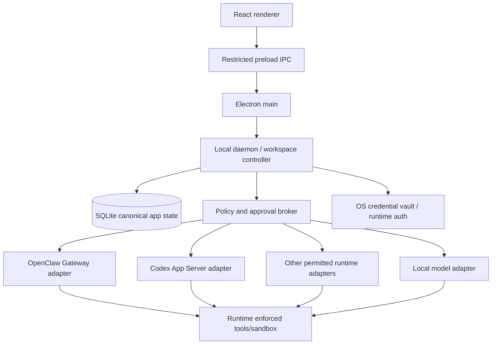

# Architecture

## Stack (proposed, verify versions in Phase 0)
Electron main/preload + React/TS/Vite renderer, Tailwind/shadcn/Radix, Zustand and TanStack Query, pnpm monorepo; Node daemon, Fastify only if authenticated local HTTP is needed, WebSocket/JSON-RPC/ACP adapters, SQLite/Drizzle, Zod, Vitest/Playwright. xterm.js/node-pty, rootless Podman, Playwright browser, isolated Xvfb/VNC/noVNC later. OS Secret Service for credentials.

Policy shown logically: actual execution must also be restricted inside each runtime. Do not claim a broker can intercept unobservable internal tools. Unsupported policy combinations are disabled. Native agent runtimes own their internal agent loop and sessions; do not nest an autonomous OpenClaw loop around a second autonomous runtime indiscriminately.

## Boundaries
Renderer has no Node, secrets or direct CLI. Preload exposes allowlisted typed calls. Main supervises daemon and OS integration. Daemon owns app agents, teams, jobs, canonical message/event projection, settings and audit; runtime owns internal state, runtime-specific memory and provider auth where applicable. OpenClaw-owned routines/tools are linked by external IDs, not double-scheduled. App scheduler owns app-level tasks only. Reconcile events after reconnect and make operations idempotent. One workspace directory per agent; shared directory granted explicitly.

## Runtime abstraction
`packages/shared-types/runtime.ts` defines initial contracts; update after official protocol discovery. Provider = vendor, auth = eligible subscription/API/local, model = selectable capability, runtime = execution owner. Use capability flags for attachments, streaming, approvals, sandbox, tools, usage and efforts. Normalize events with sequence, timestamp, runId and runtime IDs. Do not store private reasoning. Cancel and resume semantics are runtime-specific; no pretend portability.

## Deployment
Start single-user local. Bind IPC/daemon to local socket or loopback with random auth token and origin validation. Keep no internet-exposed gateway by default. Fedora systemd user service later with explicit enablement; sleep/shutdown interrupts local schedules. Remote worker only after threat model and encrypted transport. Electron sandbox/contextIsolation on, nodeIntegration off, CSP, strict navigation and external-link handling. Verify Wayland compatibility.

## Phase 0 & Phase 1 evidence

See [provider matrix](PROVIDER_MATRIX.md) for the observed Codex and OpenClaw surfaces. [ADR 0003](adr/0003-provider-probes-and-permissions.md), [ADR 0004](adr/0004-codex-jsonrpc-and-sandbox-containment.md), and [ADR 0005](adr/0005-node-sqlite-and-drizzle.md) record protocol discovery, sandbox containment, and `node:sqlite` + Drizzle decisions. The daemon owns `RuntimeRegistry` (`apps/daemon/src/runtime/registry.ts`), `RuntimePolicyBroker` (`apps/daemon/src/runtime/policy-broker.ts`), `BotRepository`, and `SettingsRepository` (`apps/daemon/src/settings/repository.ts`).
